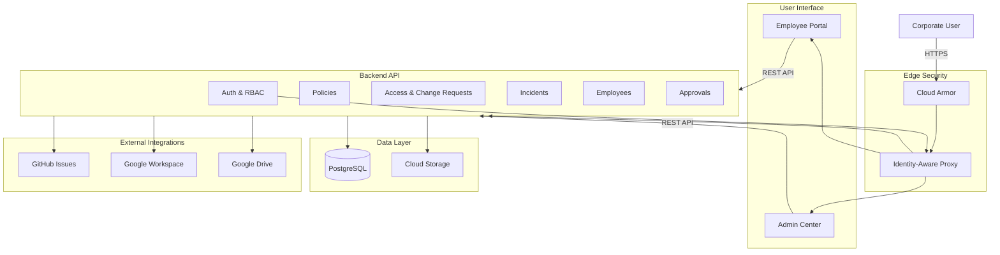

# Ateitis Internal Corporate Portal & Admin Center
## Enterprise Information Security Management System (ISMS) and Corporate Operations Platform

---

## 1. Project Overview

Ateitis is an internal corporate portal and admin center designed to centralize enterprise operations, information security management, and employee administration. The platform serves as the primary interface for employees to access company policies, submit internal requests, report security incidents, and manage approvals.

The platform supports corporate users who need:
- A unified interface for accessing ISMS policies and operational manuals
- Self-service workflows for access requests, licensing requests, and change management
- Tools for incident reporting and security incident tracking
- Administrative capabilities for employee lifecycle management and approval workflows

The main business objective is to replace fragmented internal workflows—currently spread across Google Sites, Google Apps Script, and Google Sheets—with a centralized, database-backed platform that provides consistent, auditable processes and better operational control.

The platform scope includes identity and access management, policy distribution and acceptance tracking, request and approval workflows, incident management, employee lifecycle tracking, and integration with external systems such as Google Workspace and GitHub.

---

## 2. Business Problem

Internal corporate operations were previously managed through disconnected tools and manual processes:

- **Fragmented Information**: Corporate policies, manuals, and procedures were distributed across Google Sites and shared documents, making it difficult to ensure employees accessed current versions.
- **Manual Request Workflows**: Access requests, licensing requests, and change approvals were handled through email threads and Google Sheets, with inconsistent tracking and no centralized audit trail.
- **Limited Policy Enforcement**: ISMS policy acceptance was tracked manually with no automated enforcement or versioning.
- **Ad-Hoc Incident Management**: Security incidents were reported through informal channels with limited tracking, assignment, and investigation workflows.
- **Employee Lifecycle Gaps**: Employee onboarding, offboarding, and compliance documentation lacked a unified system.
- **Operational Blind Spots**: Administrative teams lacked visibility into request status, approval backlogs, and compliance metrics.

The platform addresses these challenges by providing a centralized, database-backed system with:
- Single source of truth for policies and manuals with version control
- Structured request and approval workflows with audit trails
- Automated policy acceptance tracking and enforcement
- Incident management with assignment and investigation capabilities
- Employee lifecycle management with compliance documentation
- Role-based access control and consistent authorization

---

## 3. Solution Overview

The Ateitis platform consists of two main applications:

- **Employee Portal**: A React-based self-service interface where employees view policies, submit requests, report incidents, and access company information.
- **Admin Center**: A React-based administrative interface for managing employees, reviewing approvals, overseeing incidents, and configuring platform settings.

The backend is built as a modular NestJS application with PostgreSQL persistence. Domain modules—such as policies, access requests, change requests, incidents, and employees—are implemented as vertical slices with clear boundaries. Each module includes its own controllers, services, DTOs, and tests.

Identity and access control is handled through Google Identity-Aware Proxy (IAP) at the edge, with Google Workspace providing Single Sign-On. The backend implements role-based access control (RBAC) with permission guards, allowing fine-grained authorization for different user roles.

ISMS policy enforcement is implemented through a backend policy acceptance tracking system. Policies are versioned with effective dates, and acceptance is recorded per user per version. The platform tracks which users have accepted which policy versions, enabling compliance reporting.

External integrations use a ports-and-adapters pattern. Business logic interacts with well-defined port interfaces, while adapter implementations handle provider-specific details. Mock adapters support development and testing without requiring real provider credentials. Real adapters are implemented for GitHub Issues and Google Cloud Storage.

The platform is deployed on Google Cloud Platform using Cloud Run for serverless hosting, Cloud SQL for the PostgreSQL database, and Cloud Storage for file attachments. Infrastructure is managed through Terraform, and CI/CD is automated through GitHub Actions with Workload Identity Federation for secure authentication without long-lived credentials.



---

## 4. My Role and Responsibilities

**Full-Stack & DevOps Engineer — Part-Time Contract**

I led significant parts of the technical design and implementation of the Ateitis platform. My contributions spanned full-stack development, backend architecture, integration design, cloud infrastructure, and CI/CD automation.

**Technical Design and Architecture**
- Designed the modular backend architecture with vertical-sliced domain modules
- Created comprehensive system architecture documentation and ERDs
- Defined the ports-and-adapters pattern for external integrations
- Specified the role-based access control model with workspace group synchronization

**Database Architecture**
- Designed the PostgreSQL schema using Prisma ORM with 30+ entities
- Created entity relationships for policies, requests, incidents, employee lifecycle, and approvals
- Designed the role assignment model with multiple sources (LEGACY, WORKSPACE_GROUP, EMPLOYEE_BASELINE)
- Defined constraints and indexes for performance and data integrity

**Full-Stack Development**
- Developed backend domain services for policies, access requests, change requests, incidents, approvals, and file storage
- Implemented frontend pages and workflows for policy viewing, request submission, incident reporting, and approval management
- Built React components with TanStack Query for server state management
- Integrated frontend with backend REST APIs

**Enterprise Authorization**
- Implemented Google IAP token verification in the backend
- Designed and implemented the RBAC system with permission guards
- Created the workspace role synchronization service for automated role assignment from Google Workspace groups
- Implemented role assignment staleness detection for workspace-derived roles

**Integration Architecture**
- Designed the file storage port interface with mock and GCS adapters
- Implemented GitHub Issues integration with JWT-based GitHub App authentication
- Created the workspace directory adapter interface with mock implementation
- Designed the shared drive provisioning adapter interface with mock implementation

**Cloud Infrastructure**
- Implemented Terraform configuration for Google Cloud development environment
- Configured Cloud Run services for backend and frontend
- Set up Cloud SQL PostgreSQL instance with private networking
- Configured Cloud Storage bucket with uniform access and public access prevention
- Implemented VPC, subnets, and private service access for Cloud SQL connectivity

**CI/CD Implementation**
- Created GitHub Actions workflows for backend and frontend CI/CD
- Implemented Workload Identity Federation for secure GCP authentication without long-lived JSON keys
- Configured Docker multi-stage builds for backend and frontend
- Set up automated database migrations via Cloud Run Jobs
- Integrated Gitleaks for secret scanning

**Testing**
- Implemented unit tests for backend services, controllers, guards, and adapters
- Created E2E tests for major domain workflows (employees, policies, access requests, change requests, incidents, approvals)
- Set up mock adapters for external integrations in tests
- Configured Jest with coverage reporting

---

## 5. Architecture and Technology Stack

### Architecture Overview

The platform follows a layered architecture with clear separation of concerns:

- **Edge Layer**: Google Cloud Armor provides DDoS protection and WAF. Google Identity-Aware Proxy handles authentication and issues JWT assertions.
- **Application Layer**: Cloud Run hosts the backend (NestJS) and frontend (React with nginx) as serverless containers.
- **Data Layer**: Cloud SQL PostgreSQL provides relational database persistence. Cloud Storage provides object storage for file attachments.
- **Integration Layer**: External providers (GitHub, Google Workspace, Google Drive) are integrated through ports-and-adapters.
- **Infrastructure Layer**: Terraform manages GCP resources. GitHub Actions automates CI/CD.

### Technology Stack

**Frontend**
- **React 19**: UI framework for building the employee portal and admin center
- **TypeScript 6**: Type-safe JavaScript for frontend development
- **Vite 8**: Build tool and development server with fast hot module replacement
- **React Router 7**: Client-side routing for single-page application navigation
- **TanStack Query 5**: Server state management and API client for data fetching
- **Tailwind CSS 4**: Utility-first CSS framework for styling

**Backend**
- **NestJS 11**: Progressive Node.js framework for building the backend API
- **TypeScript 5**: Type-safe JavaScript for backend development
- **Node.js 22**: JavaScript runtime
- **Prisma ORM 7**: Type-safe database access with migrations
- **PostgreSQL Driver (pg 8)**: Database driver adapter for Prisma
- **class-validator**: DTO validation with decorators
- **google-auth-library**: Google authentication and JWT verification
- **@google-cloud/storage**: Google Cloud Storage SDK for file operations
- **@nestjs/schedule**: Task scheduling for automated role synchronization

**Database**
- **PostgreSQL 16**: Relational database on Cloud SQL
- **Prisma ORM**: Database client with type-safe queries and migrations

**Cloud Infrastructure**
- **Google Cloud Run**: Serverless container hosting for backend and frontend
- **Google Cloud SQL**: Managed PostgreSQL database
- **Google Cloud Storage**: Object storage for file attachments
- **Google Cloud Armor**: DDoS protection and web application firewall
- **Google Identity-Aware Proxy**: Edge authentication and authorization
- **Google Secret Manager**: Secure secret storage for credentials
- **Google Cloud Load Balancing**: Global traffic routing and SSL termination
- **Google Artifact Registry**: Docker image registry
- **VPC**: Private networking with subnets
- **Private Service Access**: Private connectivity for Cloud SQL

**CI/CD and Infrastructure as Code**
- **Terraform**: Infrastructure as Code for provisioning GCP resources
- **Docker**: Containerization for backend and frontend
- **GitHub Actions**: CI/CD automation
- **Workload Identity Federation**: OIDC-based authentication for GitHub Actions to GCP

**Testing**
- **Jest**: Unit testing framework
- **Supertest**: HTTP endpoint testing for E2E tests
- **NestJS Testing**: NestJS-specific testing utilities

```mermaid
flowchart TB
    subgraph Frontend["Frontend Stack"]
        React[React 19]
        TypeScript[TypeScript 6]
        Vite[Vite 8]
        Router[React Router 7]
        Query[TanStack Query 5]
        Tailwind[Tailwind CSS 4]
    end
    
    subgraph Backend["Backend Stack"]
        NestJS[NestJS 11]
        TSBackend[TypeScript 5]
        Node[Node.js 22]
        Prisma[Prisma ORM 7]
        PG[PostgreSQL Driver]
        Validator[class-validator]
        GoogleAuth[google-auth-library]
        GCS[@google-cloud/storage]
        Schedule[@nestjs/schedule]
    end
    
    subgraph Database["Database Stack"]
        PostgreSQL[PostgreSQL 16]
        PrismaClient[Prisma Client]
    end
    
    subgraph Cloud["Cloud Infrastructure"]
        CloudRun[Cloud Run]
        CloudSQL[Cloud SQL]
        Storage[Cloud Storage]
        Armor[Cloud Armor]
        IAP[Identity-Aware Proxy]
        SecretMgr[Secret Manager]
        LB[Load Balancer]
        ArtifactReg[Artifact Registry]
        VPC[VPC]
    end
    
    subgraph IaC["IaC & CI/CD"]
        Terraform[Terraform]
        Docker[Docker]
        GitHub[GitHub Actions]
        OIDC[Workload Identity Federation]
    end
    
    subgraph Testing["Testing"]
        Jest[Jest]
        Supertest[Supertest]
        NestTest[NestJS Testing]
    end
    
    React --> TypeScript
    TypeScript --> Vite
    Router --> React
    Query --> React
    Tailwind --> React
    
    NestJS --> TSBackend
    TSBackend --> Node
    Prisma --> PG
    Prisma --> PostgreSQL
    Validator --> NestJS
    GoogleAuth --> NestJS
    GCS --> NestJS
    Schedule --> NestJS
    
    NestJS --> CloudRun
    React --> CloudRun
    PostgreSQL --> CloudSQL
    Storage --> Cloud
    Armor --> Cloud
    IAP --> Cloud
    SecretMgr --> Cloud
    LB --> Cloud
    ArtifactReg --> Cloud
    VPC --> Cloud
    
    Terraform --> Cloud
    Docker --> CloudRun
    GitHub --> OIDC
    OIDC --> Cloud
    
    Jest --> NestJS
    Supertest --> NestJS
    NestTest --> NestJS
```

---

## 6. Key Engineering Challenges and Solutions

| Engineering Challenge | Technical Approach | Engineering Value |
|---------------------|-------------------|-------------------|
| **Enterprise Identity and Access Control** | Implemented Google IAP for edge authentication with JWT verification. Backend validates JWT assertions and extracts Google subject ID. RBAC with permission guards enforces authorization at controller level. Workspace group synchronization automates role assignment from Google Workspace groups. | Provides secure, enterprise-grade authentication without managing user credentials. Centralized authorization with granular permissions. Automated role management reduces administrative overhead. |
| **ISMS Policy Enforcement** | Designed policy acceptance tracking with versioning. Policies have effective dates and mandatory flags. Acceptance is recorded per user per version in the database. Backend checks acceptance status when serving policies. Current effective version determined by timestamp. | Enables compliance tracking and audit trails. Supports policy versioning without breaking existing acceptances. Provides foundation for future enforcement mechanisms. |
| **Employee Lifecycle and Identity Linking** | Designed Employee entity linked to User entity via optional foreign key. Employee lifecycle tracked through EmployeeLifecycle records with checklists and IAM operations. Compliance documents (NDAs, contracts) tracked separately. Workspace identity linking through googleSubjectId in User entity. | Separates identity (User) from employment status (Employee). Supports users without employee records (contractors, admins). Tracks lifecycle events with associated tasks and IAM operations. |
| **Modular Domain Workflows** | Implemented vertical-sliced domain modules (policies, access-requests, change-requests, incidents, approvals, employees). Each module has controller, service, DTOs, and tests. Shared dependencies through global modules (Prisma, Auth). Cross-module communication through services. | Clear domain boundaries improve maintainability. Independent development of features. Reduced coupling between unrelated domains. Easier onboarding for new developers. |
| **External Provider Integration** | Implemented ports-and-adapters pattern. Port interfaces define contracts (FILE_STORAGE_PORT, GITHUB_ISSUES_PORT, WORKSPACE_DIRECTORY_ADAPTER). Mock adapters for development and testing. Real adapters implement provider-specific logic. Factory selects adapter based on environment configuration. | Decouples business logic from external providers. Enables development without real credentials. Supports testing with predictable mocks. Allows provider changes without modifying business logic. |
| **Mock and Real Integration Strategy** | Provided mock adapters for all external integrations (File Storage, GitHub Issues, Workspace Directory, Shared Drive Provisioning). Real adapters implemented for File Storage (GCS) and GitHub Issues. Configuration variables (FILE_STORAGE_MODE, INCIDENT_GITHUB_ISSUES_MODE) control adapter selection. Production rejects mock storage configuration. | Supports local development and offline work. Makes tests deterministic and fast. Reduces dependency on external service availability. Provides clear path to production integration. |
| **Secure Cloud Delivery** | Implemented Terraform for infrastructure provisioning. Multi-stage Docker builds for backend and frontend. GitHub Actions workflows with build, test, and security scanning. Workload Identity Federation for GCP authentication without long-lived JSON keys. Cloud Run Jobs for database migrations. | Repeatable infrastructure deployment. No credential management overhead. Automated testing and security scanning. Consistent deployment across environments. Zero-downtime database migrations. |
| **Automated Testing** | Implemented unit tests for services, controllers, guards, and adapters using Jest. E2E tests for major domain workflows using Supertest. Mock adapters used in tests to avoid external dependencies. Coverage reporting configured. Test setup isolates test environment. | Ensures code quality and correctness. Catches regressions early. Validates integration points without external dependencies. Provides confidence in refactoring. |

---

## 7. Selected Implemented Capabilities

### Identity and Access Management
- **Implemented**: Google IAP authentication with JWT verification
- **Implemented**: RBAC with permission guards at controller level
- **Implemented**: Workspace role synchronization service (mock adapter in production)
- **Implemented**: Role assignment with multiple sources (LEGACY, WORKSPACE_GROUP, EMPLOYEE_BASELINE)
- **Implemented**: User profile and permission querying API

### Policy and Manual Management
- **Implemented**: ISMS policy listing and detail views
- **Implemented**: Policy acceptance tracking per user per version
- **Implemented**: Manual listing and detail views
- **Implemented**: Policy and manual versioning with effective dates
- **Implemented**: Drive file reference storage for documents

### Access and Licensing Workflows
- **Implemented**: Access request submission with access items
- **Implemented**: Licensing request submission with license items
- **Implemented**: OAuth request details with scopes
- **Implemented**: Shared drive request with member assignments
- **Implemented**: Mock shared drive provisioning adapter

### Change Management
- **Implemented**: Change request submission with file attachments
- **Implemented**: Change request detail view with attachments
- **Implemented**: GitHub Issues integration for change requests (REAL adapter implemented)
- **Implemented**: File storage integration (REAL GCS adapter implemented)

### Incident Management
- **Implemented**: Incident reporting with evidence attachments
- **Implemented**: Incident assignment to SecOps users
- **Implemented**: Incident comments and actions
- **Implemented**: GitHub Issues integration for incidents (REAL adapter implemented)
- **Implemented**: Incident management interface for SecOps

### Approval Workflows
- **Implemented**: Centralized approval workflow for access requests
- **Implemented**: Centralized approval workflow for change requests
- **Implemented**: Approval detail view with decision tracking
- **Implemented**: Multi-stage approval support

### Employee Management
- **Implemented**: Employee record creation and management (service implemented, controller not exposed)
- **Implemented**: Employee lifecycle tracking with checklists
- **Implemented**: Employee compliance document tracking
- **Implemented**: Employee lifecycle IAM operation tracking

### File Storage
- **Implemented**: Shared file storage port interface
- **Implemented**: Mock storage adapter for development and testing
- **Implemented**: Real GCS adapter for file uploads, downloads, and deletion
- **Implemented**: Terraform-managed GCS bucket with uniform access
- **Implemented**: File attachment metadata for change requests and incidents

### GitHub Integration
- **Implemented**: GitHub App authentication with JWT-based installation tokens
- **Implemented**: GitHub Issues integration for change requests (REAL)
- **Implemented**: GitHub Issues integration for incidents (REAL)
- **Implemented**: Mock adapter for development and testing

### Automated Testing
- **Implemented**: Unit tests for backend services, controllers, guards, and adapters
- **Implemented**: E2E tests for major domain workflows
- **Implemented**: Mock adapters for external integrations in tests
- **Implemented**: Coverage reporting configured

---

## 8. Engineering Workflow

The platform was developed using a vertical-slice implementation approach. Each domain module was implemented as a complete vertical slice from database to frontend UI:

1. **Database Design**: Prisma schema entities and relationships were defined for the domain
2. **Backend API**: NestJS controller, service, DTOs, and tests were implemented
3. **Frontend Integration**: React pages and API client modules were created
4. **Automated Tests**: Unit tests and E2E tests were added for the workflow
5. **Mock Integration**: External provider integrations used mock adapters initially
6. **Real Integration**: Real adapters were implemented where applicable

Database-backed features were prioritized to ensure data persistence and relationships were correct from the start. Backend APIs and services were developed with validation, error handling, and authorization guards. Frontend integration followed, with TanStack Query managing server state and React Router handling navigation.

External providers were mocked during development to enable local work without credentials. Real adapters were implemented for GitHub Issues and Google Cloud Storage. The ports-and-adapters pattern allowed swapping adapters without modifying business logic.

Incremental implementation allowed each module to be tested and validated independently. Cross-cutting concerns such as security hardening, logging, and monitoring were tracked separately and applied across modules consistently.

---

## 9. Security and DevSecOps

### Implemented Security Controls

**IAP-Protected Access**
- All traffic routed through Google Identity-Aware Proxy
- JWT assertions verified at the edge before reaching application
- Only authorized Google Workspace users can access the platform
- Development authentication bypass available for local development

**Backend RBAC**
- Role-based access control with granular permissions
- Permission guards enforce authorization at controller level
- User status check denies access to inactive users
- Workspace-derived roles expire after 30 minutes (staleness detection)

**ISMS Policy Enforcement**
- Mandatory policy acceptance tracking per user per version
- Policy versioning with effective dates
- Current effective version determined by timestamp
- Acceptance status checked when serving policies

**Secure CI/CD Identity**
- GitHub Actions authenticates to GCP via Workload Identity Federation
- No long-lived JSON keys or static credentials in CI/CD
- Service account impersonation with time-bound credentials
- Least-privilege IAM roles for CI/CD service account

**Secret Management**
- Database credentials stored in Google Secret Manager
- GitHub App private key stored in Secret Manager
- Secrets injected into Cloud Run via environment variables
- Backend service account has least-privilege access to secrets

**Infrastructure as Code**
- Terraform manages all GCP infrastructure
- Infrastructure defined as code for version control and review
- Consistent deployment across environments
- No manual infrastructure configuration

**Automated Testing**
- Unit tests for backend services, controllers, guards, and adapters
- E2E tests for major domain workflows
- Mock adapters used in tests to avoid external dependencies
- Coverage reporting configured

**Security Scanning**
- Gitleaks integrated in CI/CD for secret scanning
- CodeQL SAST temporarily disabled (repository configuration limitation)
- Dependency scanning not yet implemented
- Container scanning not yet implemented

**Logging and Audit**
- GCP Cloud Logging captures application logs
- IAP access logs available in Cloud Logging
- Database operations logged via Prisma
- Audit log retention uses default GCP settings (explicit 365-day retention not yet configured)

### ISO 27001 Context

The platform is designed in the context of ISO 27001:2022 requirements for information security management. ISMS policy acceptance tracking, incident management, access control, and audit logging are implemented to support compliance objectives. However, the organization has not achieved ISO 27001 certification, and the platform itself does not claim full compliance.

---

## 10. Engineering Outcomes

The platform demonstrates several engineering outcomes:

**Centralized Internal Platform Capabilities**
- Replaced fragmented tools with a unified, database-backed system
- Provided consistent user experience across employee and admin interfaces
- Enabled audit trails for requests, approvals, and policy acceptance

**Modular Backend Architecture**
- Vertical-sliced domain modules with clear boundaries
- Reusable integration boundaries through ports-and-adapters
- Improved maintainability and reduced coupling between domains

**Database-Backed Business Workflows**
- PostgreSQL schema with 30+ entities supporting complex relationships
- Type-safe database access via Prisma ORM
- Automated migrations for schema changes

**Reusable Integration Boundaries**
- Port interfaces abstract external provider dependencies
- Mock adapters support development and testing
- Real adapters implemented for GitHub Issues and Google Cloud Storage

**Automated Testing**
- Unit tests and E2E tests for major workflows
- Mock adapters enable deterministic testing
- Coverage reporting supports quality metrics

**Repeatable Infrastructure and Deployment**
- Terraform manages GCP infrastructure as code
- GitHub Actions automates CI/CD with Workload Identity Federation
- Cloud Run Jobs execute database migrations
- No manual infrastructure configuration required

**Improved Maintainability**
- Modular domain design supports independent feature development
- Clear separation of concerns between layers
- Type safety across frontend and backend with TypeScript

---

## 11. Technologies Used

**Frontend**
- React 19, TypeScript 6, Vite 8, React Router 7, TanStack Query 5, Tailwind CSS 4

**Backend**
- NestJS 11, TypeScript 5, Node.js 22, Prisma ORM 7, PostgreSQL Driver (pg 8), class-validator, google-auth-library, @google-cloud/storage, @nestjs/schedule

**Database**
- PostgreSQL 16, Prisma ORM

**Cloud Infrastructure**
- Google Cloud Run, Google Cloud SQL, Google Cloud Storage, Google Cloud Armor, Google Identity-Aware Proxy, Google Secret Manager, Google Cloud Load Balancing, Google Artifact Registry, VPC, Private Service Access

**CI/CD and Infrastructure as Code**
- Terraform, Docker, GitHub Actions, Workload Identity Federation

**Testing**
- Jest, Supertest, NestJS Testing

---

## 12. Project Status and Limitations

### Implemented

- **Backend API**: Fully implemented with 15 domain modules (policies, access-requests, change-requests, incidents, approvals, employees, benefits, corporate-events, suggestions, manuals, users, auth, file-storage, github-issues, shared-drive-provisioning)
- **Frontend Application**: Fully implemented with React 19, Vite, and React Router, including all major pages
- **Authentication**: Google IAP with development authentication fallback
- **Authorization**: RBAC with permission guards and workspace role synchronization service
- **Database**: PostgreSQL schema with 30+ entities and relationships
- **File Storage**: Real GCS adapter implemented and configured in development environment
- **GitHub Issues**: Real adapter implemented for both Change Requests and Incidents, configured in development environment
- **CI/CD**: GitHub Actions workflows with Workload Identity Federation, Gitleaks secret scanning
- **Infrastructure**: Terraform configuration for development environment on GCP
- **Testing**: Unit tests and E2E tests implemented for major workflows

### Partially Implemented

- **Employees Module**: Service fully implemented but controller not exposed via API
- **Workspace Role Synchronization**: Service implemented but Workspace Directory adapter is mocked in production (real adapter not implemented)
- **Policy Enforcement**: Acceptance tracking implemented but not enforced as blocking mechanism (fail-open)

### Mocked in Production

- **Google Workspace Directory**: Mock adapter used in production (real adapter not implemented)
- **Shared Drive Provisioning**: Mock adapter used in production (real adapter not implemented)

### Pending Configuration

- **Production Environment**: Infrastructure not defined for production (only development environment configured)
- **CodeQL SAST**: Temporarily disabled due to repository configuration limitations
- **Audit Log Retention**: Not explicitly configured (uses default GCP retention)
- **Bucket Lifecycle Policies**: Not configured for file attachments
- **Signed URLs**: Not implemented for secure file downloads

### Deferred Hardening

- **Dependency Scanning**: Not implemented
- **Container Scanning**: Not implemented
- **Rate Limiting**: Not implemented beyond Cloud Armor
- **File Size Limits**: Not validated
- **File Format Restrictions**: Not validated
- **Attachment Count Limits**: Not enforced
- **File Retention Policies**: Not configured
- **Orphan File Reconciliation**: Not implemented

### Development Status

The platform is in active development for the development environment. The current implementation provides a functional foundation with core workflows, but production deployment requires additional configuration, real adapter implementations for Workspace Directory and Shared Drive Provisioning, and deferred hardening activities.

---

## 13. Portfolio Summary

I designed and implemented significant portions of the Ateitis Internal Corporate Portal, an enterprise ISMS and operations platform built with React, NestJS, PostgreSQL, and Google Cloud Platform. I led the technical design of the modular backend architecture, database schema with 30+ entities, and role-based access control system with workspace group synchronization. I developed backend domain services for policies, access requests, change requests, incidents, and approvals, implemented the ports-and-adapters pattern for external integrations, and built React frontend workflows. I provisioned Google Cloud infrastructure using Terraform, implemented secure CI/CD with GitHub Actions and Workload Identity Federation, and established automated testing with unit and E2E tests. The platform demonstrates enterprise-grade security through IAP authentication, RBAC authorization, ISMS policy enforcement, and secret management, providing a centralized, database-backed system for corporate operations and information security management.
