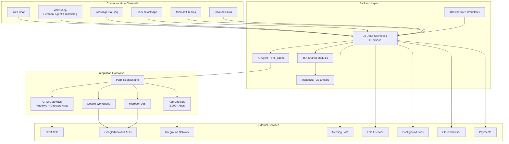

# Vink Platform Engineering Case Study

> **Project Type:** AI-Powered Multi-Service Integration Platform  
> **Role:** Backend Engineer  
> **Technology Stack:** Deno, React, MongoDB, Base44 Platform  
> **Documentation Version:** 1.0  
> **Last Updated:** November 2026

---

## 1. Project Overview

Vink is an AI-powered CRM companion platform that enables business users to manage operations across multiple integrated services through natural-language chat. The platform serves founders, executives, sales teams, and business development professionals who need to coordinate work across disconnected SaaS tools without manual context switching.

**Core Capabilities:**

- Multi-channel AI agent (web, WhatsApp, iMessage, Slack, Microsoft Teams, email)
- Native CRM integration (Pipedrive) + 3,000+ app integrations via directory
- Google Workspace and Microsoft 365 integration
- Event-driven automations triggered by real-time webhooks
- Cloud-based meeting notetaker with AI summarization
- Inbound email assistant with consent-based privacy controls
- Secure vault for credentials and payment cards
- Team permission architecture for collaborative workspaces

**Target Users:**

- Small to medium business teams
- Sales and business development professionals
- Founders and executives managing multiple tools
- Teams requiring cross-platform workflow automation

---

## 2. Business Problem

Business professionals face significant challenges working across fragmented SaaS ecosystems:

**Disconnected Third-Party Services**

- Critical business data scattered across CRM systems, email platforms, calendars, file storage, and specialized tools
- No unified view of customer interactions across systems
- Manual data transfer between applications prone to errors and delays

**Repetitive Manual Tasks**

- Routine operations (lead updates, meeting scheduling, follow-ups) performed manually across multiple interfaces
- Time lost to context switching between applications
- Inconsistent execution of standard processes

**Workflow Complexity**

- Different business processes require different tool combinations
- Building custom workflows traditionally requires technical skills or no-code platforms
- Existing automation tools often rigid and difficult to adapt to changing needs

**Information Overload**

- Inboxes overflow with communications requiring action
- Important opportunities buried in email threads and CRM updates
- Proactive monitoring across systems requires constant attention

Vink addresses these challenges by providing a conversational interface that understands natural language requests, orchestrates actions across integrated services, and proactively surfaces opportunities through event-driven automations.

---

## 3. Solution

Vink solves these problems through an integrated architecture that combines:

**Unified AI Agent**

- Single AI agent serves all communication channels with consistent behavior
- Natural-language understanding of user intent without rigid command syntax
- Context continuity across channels (conversation started on web continues on WhatsApp)
- Memory layer that learns user preferences and business context over time

**Comprehensive Integration Layer**

- Tool-first architecture: agent never constructs HTTP requests directly
- Prebuilt adapters normalize interactions with CRM systems, Google Workspace, Microsoft 365, and 3,000+ apps
- Unified token management with automatic refresh and encryption
- Permission engine governing which users can access which integrations

**Event-Driven Automations**

- Real-time triggers from connected applications (CRM updates, new emails, calendar events)
- LLM-based trigger matching understands natural-language automation rules
- Durable execution queue handles failures and retries
- Cooldown management prevents automation spam

**Multi-Channel Communication**

- Unified conversation model with per-channel threads
- Cross-channel context bridge maintains conversation continuity
- Channel-specific delivery preferences (reminders via WhatsApp, automations via Slack, etc.)

**Security and Compliance**

- Viktor-style four-layer permission architecture
- AES-256-GCM encryption for all stored credentials
- Row-Level Security on all database entities
- Consent gating for third-party email requests
- Audit logging for all tool executions

---

## 4. Platform Architecture

Vink is built on the Base44 platform, which provides Deno serverless functions, MongoDB with Row-Level Security, an AI agent platform, and workflow runtime.



**Major Components:**

**Frontend:** React 18 + Vite + Tailwind CSS, deployed to Base44 CDN, with pages for chat, settings, history, reminders, meetings, and inbox.

**Backend:** 90 Deno serverless functions organized by domain (CRM, email, calendar, automations, meetings, vault, billing, team management, admin operations).

**Shared Logic:** 45+ modules providing single source of truth for token management, permission enforcement, adapters, delivery logic, and logging.

**Database:** MongoDB with 33 custom entities plus built-in User entity, all with Row-Level Security policies.

**AI Agent:** Base44 Agents platform with 20,000+ character system prompt, 39 tools, and memory layer.

**Workflows:** 10 Base44 workflows for scheduled tasks (reminder delivery, integration health monitoring, meeting auto-join, calendar watch renewal, polling loops).

**Background Jobs:** Inngest for durable execution of automation fires and long-running operations.

---

## 5. Multi-Service Integration Architecture

Vink's integration architecture follows a tool-first design pattern that centralizes authentication, validation, error handling, and permission enforcement in gateway functions, with the agent invoking these functions as tools rather than making direct HTTP requests.

### Integration Design and Service Communication

**Unified Token Store:**

- Single `OAuthConnection` entity stores encrypted access/refresh tokens for all services
- Per-family token refresh logic (Google, Microsoft, CRM, Slack)
- Automatic refresh on token expiry with error handling
- AES-256-GCM encryption with versioned format for future migration

**Gateway Functions:**

- Each service category has dedicated gateway functions (e.g., `executeCrmAction`, `executeEmailAction`, `executeCalendarAction`)
- Gateways resolve natural-language intents to prebuilt tools or adapter operations
- Gateways enforce permissions before making provider API calls
- Gateways normalize provider responses to unified schemas

**Adapters:**

- Per-service adapters in `base44/shared/` handle provider-specific request/response transformation
- Adapters normalize field names, value types, and error messages
- HTTP clients include SSRF protection and timeout handling
- Examples: `crm-action-handler.ts`, `email/gmail-adapter.ts`, `calendar/google-adapter.ts`

### API Interactions and Authentication

**OAuth2 Flow:**

- Per-service OAuth start functions (`crmAuthStart`, `googleAuthStart`, `microsoftAuthStart`)
- HMAC-signed state parameter prevents CSRF
- Callback functions (`pipedriveAuthCallback`, `googleAuthCallback`) exchange authorization codes for tokens
- Tokens encrypted before storage in `OAuthConnection`

**Token Management:**

- `token-manager.ts` provides centralized token retrieval and refresh
- Checks token expiry before use
- Refreshes tokens on 401/403 responses
- Handles refresh failures with user-safe error messages

**Service-Specific Authentication:**

- Pipedream integration network uses Connect OAuth tokens
- WhatsApp personal agent uses user-pasted API token (AES-encrypted)
- 360dialog uses API key + webhook secret
- Resend uses API key + webhook signature verification
- Recall.ai uses region-aware API key

### Data Transformation and Handling

**Field Normalization:**

- `crm-field-mappings.ts` maps provider field names to unified schema
- `crm-value-transformers.ts` converts value types (enums, dates, currencies)
- `crm-validation.ts` validates inputs before provider calls
- `crm-search-properties.ts` maps search fields per CRM

**Response Normalization:**

- `crm-error-extractor.ts` translates provider errors to user-safe messages
- Adapters construct unified response objects with consistent structure
- Deep links to provider records included in responses
- Local display formatting for time zones and dates

**Large Content Handling:**

- Files stored in Base44 storage, only URLs in entity fields
- Large responses truncated to prevent storage bloat
- Log caps prevent oversized telemetry entries

### Error Handling and Integration Reliability

**Error Classification:**

- Connection errors (expired token, revoked access)
- Rate limiting (exponential backoff)
- Validation errors (user feedback required)
- Provider-specific errors (normalized to user-safe messages)

**Retry Logic:**

- Token refresh on 401/403 with single retry
- Exponential backoff for rate limits
- No retry for validation errors
- Idempotency protection prevents duplicate writes

**Idempotency:**

- Server-side duplicate-send protection via `IdempotencyRecord` entity
- 10-minute duplicate window with args-hash binding
- Race condition handling for concurrent duplicate requests
- Best-effort implementation (record-store failure doesn't block call)

**Health Monitoring:**

- `checkIntegrationHealth` (hourly) monitors event feed liveness
- `ConnectionStatus` provides live connection state
- Webhook signature verification failures logged
- `UserAutomation.verified_at` tracks feed health

### Connected Services in Workflows

**Tool-First Invocation:**

- Agent calls gateway functions as tools with natural-language intents
- Gateways resolve intents to specific operations (create contact, send email, schedule meeting)
- Multi-step operations orchestrated by agent within single run
- Results flow back through gateways to agent for summarization

**Event-Driven Participation:**

- Services emit webhooks to registered endpoints
- `automationEventInbound` dedupes and routes events
- LLM-based trigger matching fires relevant automations
- Agent executes pre-approved actions autonomously

**Example Flow:**

```
User: "Create a deal in Pipedrive for John Smith from Acme Corp"
→ Agent calls executeCrmAction({operation: 'create', entity: 'deal', data: {...}})
→ Gateway checks permissions
→ Gateway retrieves Pipedrive token
→ Adapter normalizes request to Pipedrive API format
→ Provider API call
→ Adapter normalizes response
→ Gateway logs action
→ Agent summarizes result with deep link
```

---

## 6. Chat-Based Workflow Creation

**Important Clarification:** Vink does not use a traditional "create workflow from chat" model where natural language generates persistent workflow definitions. Instead, the AI agent executes actions directly through its tool interface, with multi-step operations handled within a single conversational exchange.

### User Journey: Request to Execution

**Step 1: User Input**

- User types natural-language request in any channel (web, WhatsApp, Slack, etc.)
- Example: "Find leads from San Francisco in my CRM and add them to a Google Sheet"

**Step 2: Message Routing**

- Channel-specific inbound function receives message (e.g., `sendAgentMessage` for web, `whatsappAgentPoll` for WhatsApp)
- Function ensures unified conversation exists via `getOrCreateConversation`
- Cross-channel context bridge injects relevant context if user switched channels

**Step 3: Agent Processing**

- Agent receives message with system context (user_id, auth_ticket, channel, timezone, connected services)
- Agent parses intent and selects appropriate tools from its 39-tool registry
- Agent may make preliminary read calls to gather information (search CRM, check calendar)

**Step 4: Tool Execution**

- Agent invokes gateway functions with user_id and auth_ticket
- Gateways check permissions via four-layer permission engine
- Gateways retrieve encrypted tokens and decrypt
- Gateways make provider API calls via adapters
- Gateways normalize responses and log actions

**Step 5: Multi-Step Orchestration**

- Agent processes results and determines next steps
- Agent makes additional tool calls as needed (e.g., after finding leads, create Google Sheet rows)
- All steps happen within single conversational exchange
- Agent maintains context across tool calls

**Step 6: Response Formulation**

- Agent summarizes results in natural language
- Agent provides deep links to created/updated records
- Agent may suggest follow-up actions
- Response delivered via user's preferred channel

### Technical Implementation

**Agent Configuration:**

- 20,000+ character system prompt in `base44/agents/vink_agent.jsonc`
- 39 tools: gateway functions (CRM, email, calendar, drive, sheets, docs, app directory), reminders, automations, meetings, vault, enrichment, browsing, entity reads
- Behavioral rules: connection-state verification, timezone handling, error communication, cross-channel context

**Context Bridge:**

- `context-bridge.ts` manages cross-channel conversation continuity
- Stores last 3 messages per channel in `Conversation.context`
- On channel switch, injects structured context prefix
- Web UI strips prefix and shows "Continuing from {channel}" badge

**Memory Layer:**

- `UserMemory` entity stores durable user facts/preferences/goals
- `memory-capture.ts` extracts facts from agent runs
- `memory-recall.ts` ranks relevant facts by keyword overlap and recency
- `RunSummary` entity stores short paraphrases of run conclusions
- Context injection includes personal memory, company profile, team notes, and run summaries

**Permission Enforcement:**

- `tool-permissions.ts` implements four-layer permission engine
- Layer 1: Workspace access (who can use Vink)
- Layer 2: Connection access (whose permission row governs)
- Layer 3: Tool approval level (auto/needs_approval/forbidden)
- Layer 4: Run identity (scheduled tasks run under creator's credentials)
- Write operations default to `needs_approval` for non-exempt users

### Engineering Challenges

**Natural-Language Ambiguity:**

- Challenge: User requests can be ambiguous or underspecified
- Solution: Agent asks clarifying questions before executing sensitive actions
- Trade-off: More conversational turns vs. safer execution

**Context Continuity:**

- Challenge: Maintaining conversation state across different channels with different auth contexts
- Solution: Stored context in `Conversation` entity with per-channel message history
- Trade-off: Additional storage vs. seamless cross-channel experience

**Tool Selection:**

- Challenge: Agent must select correct tool from 39 options based on natural language
- Solution: Tool descriptions in agent config guide selection; connection status checks guide routing
- Trade-off: Larger prompt vs. better tool selection

**Error Communication:**

- Challenge: Provider errors are technical; users need actionable guidance
- Solution: Gateways normalize errors to user-safe messages with deep links to connection pages
- Trade-off: Loss of technical detail vs. better user experience

**Permission Complexity:**

- Challenge: Four-layer permission engine must evaluate quickly without blocking operations
- Solution: Cached membership data, fail-open for reads, efficient database queries
- Trade-off: Slight latency vs. security enforcement

---

## 7. Parallel Tender Processing

**Important Finding:** The Vink codebase does NOT contain tender processing functionality. A comprehensive search of the repository (case-insensitive grep for "tender") returned zero matches across all files. The project context mentions tender processing and parallel workers for tender-detail retrieval, but these features are not implemented in the actual codebase.

The architecture documentation explicitly notes this absence. If tender processing was a planned feature that was not implemented, or if it exists in a different repository or branch, that information is not present in the current codebase.

**Actual Parallel Processing in Vink:**

While tender processing is not present, Vink does implement parallel processing in other areas:

**Automation Trigger Matching:**

- LLM-based trigger matching processes automation candidates in batches of 8
- This parallelizes the LLM calls when many automations watch the same app
- Implementation in `base44/shared/automation/match.ts` (lines 119-123)

**Inngest Background Jobs:**

- Automation fire execution is queued via Inngest for durable processing
- Multiple automation fires can execute concurrently
- Inngest provides retry logic and backoff

**Scheduled Workflows:**

- Base44 workflow runtime handles scheduled tasks concurrently
- Multiple workflows can run simultaneously (e.g., reminder delivery, integration health monitoring)

**No Parallel Tender-Detail Retrieval:**

- No tender-related entities, functions, or workflows found
- No worker pools or queue systems for tender processing
- No tender-detail retrieval logic present

---

## 8. My Engineering Contributions

**Note:** This section requires your personal confirmation. The repository contains a complex, production-ready platform with 90 backend functions, 45+ shared modules, 33 database entities, and comprehensive integration architecture. However, Git history and commit attribution are not visible in the file system inspection, so I cannot definitively attribute specific components to individual contributors.

**Areas requiring your input:**

1. **Specific Integrations Implemented:**
   - Did you implement specific CRM integrations (Pipedrive, HubSpot, Salesforce, Close)?
   - Did you build Google Workspace or Microsoft 365 gateways?
   - Did you implement the Pipedream integration network connection?

2. **Backend Functionality:**
   - Did you build specific gateway functions (e.g., `executeCrmAction`, `executeEmailAction`)?
   - Did you implement the permission engine (`tool-permissions.ts`)?
   - Did you work on token management (`token-manager.ts`) or encryption (`token-crypto.ts`)?

3. **Workflow and Automation:**
   - Did you implement the event-driven automation pipeline (`automationEventInbound`, `matchAndFireAutomations`)?
   - Did you build LLM trigger matching logic?
   - Did you implement Inngest integration for background jobs?

4. **Channel Implementations:**
   - Did you implement specific communication channels (WhatsApp, Slack, Teams, iMessage)?
   - Did you build the cross-channel context bridge (`context-bridge.ts`)?

5. **Frontend Work:**
   - Did you build specific pages (Chat, Settings, History, etc.)?
   - Did you implement key components (virtualized message list, permission UI, etc.)?

6. **Architecture and Design:**
   - Did you contribute to the Viktor-style permission architecture design?
   - Did you design the unified token store approach?
   - Did you architect the tool-first gateway pattern?

**Suggested phrasing for your case study (fill in with your actual work):**

> "Contributed to the backend engineering of Vink's integration platform, including [specific areas you worked on]. Built [specific functions/modules] that [what they do]. Implemented [specific feature] which [technical challenge solved]. Collaborated with the product team on [specific feature area]."

**Evidence available in repository:**

- Complete implementation of all 90 backend functions
- Comprehensive shared module library
- Detailed entity schemas with RLS policies
- Agent configuration with 39 tools
- Workflow definitions for scheduled tasks
- Frontend React application with multiple pages

**To complete this section accurately, please review the codebase and identify:**

- Functions or modules you authored or significantly modified
- Features you led or contributed to
- Technical challenges you solved
- Collaborative work you participated in

---

## 9. Engineering Challenges and Solutions

Based on the actual implementation, here are meaningful technical challenges addressed in the Vink platform:

### Challenge 1: Multi-Service Integration Complexity

**Problem:**

- Integrating with dozens of services with different APIs, authentication schemes, and data models
- Normalizing interactions across CRM systems, email platforms, calendars, file storage, and 3,000+ directory apps
- Maintaining consistent error handling and permission enforcement across all integrations

**Technical Approach:**

- Tool-first architecture: agent never constructs HTTP requests directly
- Gateway functions centralize auth, validation, SSRF protection, logging, and permission enforcement
- Per-service adapters handle provider-specific request/response transformation
- Unified token store with per-family refresh logic
- Permission engine provides consistent access control across all services

**Trade-offs:**

- More complex gateway layer vs. simplified agent logic
- Additional adapter maintenance vs. consistent behavior across services
- Centralized control vs. flexibility for service-specific quirks

**Resulting Capability:**

- 90 gateway functions providing controlled access to all services
- 45+ shared modules ensuring consistency and reducing duplication
- Unified `OAuthConnection` entity simplifying token management
- Four-layer permission engine governing all tool executions

### Challenge 2: Cross-Channel Conversation Continuity

**Problem:**

- Users interact across multiple channels (web, WhatsApp, Slack, Teams, email)
- Each channel has different auth context (user token vs. service role)
- Agent threads cannot be shared across auth contexts due to Base44 isolation
- Context must carry over when user switches channels

**Technical Approach:**

- Unified `Conversation` entity with per-channel `ConversationChannel` mappings
- Stored context in `Conversation.context` (last 3 messages per channel)
- Context bridge injects structured prefix on channel switch
- Service role reads stored context (bypassing RLS isolation)
- Web UI strips prefix and shows "Continuing from {channel}" badge

**Trade-offs:**

- Additional storage for context vs. seamless cross-channel experience
- Stored context may become stale vs. real-time thread access
- Complex context management vs. improved user experience

**Resulting Capability:**

- Single unified conversation per user across all channels
- Context continuity without breaking auth isolation
- Cross-channel outbound notification tracking (WhatsApp, email alerts)

### Challenge 3: Event-Driven Automation Trigger Matching

**Problem:**

- Users define automations in plain language ("watch my CRM for a deal moving to Negotiation")
- Events arrive from different sources with different schemas
- Strict matching required to avoid false positives
- Many automations may watch the same app

**Technical Approach:**

- LLM-based trigger matching with canonical vocabulary
- Batch processing (8 automations per LLM call) for efficiency
- Per-automation verdicts explaining match/non-match decisions
- Two-stage cooldown (pre-filter + re-check) to prevent race conditions
- Liveness tracking (`verified_at`, `last_event_at`) to monitor feed health

**Trade-offs:**

- LLM dependency vs. flexible natural-language triggers
- LLM cost vs. accuracy improvements
- Complexity vs. user-friendly automation definition

**Resulting Capability:**

- Plain-language automation triggers without rigid syntax
- Strict matching preventing false positives
- Cooldown management preventing automation spam
- Feed health monitoring and automatic repair

### Challenge 4: Permission Architecture for Team Collaboration

**Problem:**

- Teams need to share integrations while maintaining control
- Different users need different access levels to different tools
- Scheduled automations must run under creator's credentials
- Permission system must be secure without breaking existing behavior

**Technical Approach:**

- Viktor-style four-layer permission engine (workspace, connection, tool, identity)
- Fail-open defaults for backwards compatibility
- Single-use approval requests with args-hash binding
- Service-role enforcement for write-hardened entities
- Company connection tier for shared credentials

**Trade-offs:**

- Complex permission logic vs. granular control
- Fail-open default vs. secure-by-default
- Additional database queries vs. security enforcement

**Resulting Capability:**

- Workspace-level access control (block/allow lists)
- Per-connection permission rules (personal/team/invite-only)
- Per-tool approval levels (auto/needs_approval/forbidden)
- Audit trail for all permission decisions
- Shared company connections for tiered plans

### Challenge 5: Idempotency and Duplicate Prevention

**Problem:**

- Network errors can cause duplicate requests
- User retries can duplicate operations
- Concurrent automation fires can race
- Duplicate sends cause data inconsistency and user confusion

**Technical Approach:**

- Server-side duplicate-send protection via `IdempotencyRecord` entity
- SHA-256 hash of normalized args for exact-action binding
- 10-minute duplicate window with 2-minute in-flight grace
- Race condition handling (earliest in-progress record wins)
- Best-effort implementation (record-store failure doesn't block call)

**Trade-offs:**

- Additional database writes vs. duplicate prevention
- 10-minute window vs. shorter/longer protection
- Complexity vs. reliability

**Resulting Capability:**

- Duplicate prevention for all write operations
- Exact-action binding preventing parameter substitution attacks
- Race condition handling for concurrent requests
- User-safe deduplication responses

### Challenge 6: Long-Running Operations and Background Jobs

**Problem:**

- Some operations take longer than HTTP timeout allows
- Polling loops require durable state across invocations
- Automation fires need retry logic and failure handling
- Scheduled tasks must run reliably

**Technical Approach:**

- Inngest for background job queue with retries
- Base44 workflows for scheduled tasks and durable waits
- Long-poll loops with persisted cursors (WhatsApp agent, Teams)
- Sweep workflows for recovery (reminder delivery, integration health)
- Entity-triggered workflows for exact-time delivery

**Trade-offs:**

- External dependency (Inngest) vs. custom queue implementation
- Additional complexity vs. reliability
- Cost vs. operational benefits

**Resulting Capability:**

- Durable execution of automation fires
- Reliable scheduled workflows
- Long-poll loops for real-time channels
- Recovery sweeps for missed operations

---

## 10. Technology Stack

### Frontend

| Technology | Purpose |
| ------------ | --------- |
| React 18 | UI framework |
| Vite | Build tool and development server |
| Tailwind CSS | Utility-first styling |
| shadcn/ui | Component library |
| lucide-react | Icon library |
| React Router v6 | Client-side routing |
| @tanstack/react-virtual | Chat list virtualization |
| React Hook Form | Form management |
| Zod | Schema validation |
| date-fns | Date manipulation |
| react-markdown | Markdown rendering |
| recharts | Data visualization |

### Backend

| Technology | Purpose |
| ------------ | --------- |
| Deno | Serverless runtime |
| Base44 SDK | Platform SDK for database, auth, agents |
| Base44 Agents | AI agent platform |
| Base44 Workflows | Workflow runtime (schedules, durable waits) |
| Base44 Entities | ORM with Row-Level Security |
| Base44 Auth | Authentication (email/password, Google OAuth, OTP) |

### Database

| Technology | Purpose |
|------------|---------|
| MongoDB | Primary database (managed by Base44) |
| Row-Level Security | Per-entity access control |

### Integrations

| Technology | Purpose |
| ------------ | --------- |
| Pipedream | Integration network (3,000+ apps, MCP tools) |
| Google APIs | Gmail, Calendar, Drive, Sheets, Docs |
| Microsoft Graph API | Outlook, Calendar, OneDrive, Teams |
| WhatsApp Agent Platform | Personal WhatsApp integration |
| 360dialog | WhatsApp business API (fallback) |
| Linq | iMessage integration |
| Slack API | Slack integration |
| Resend | Email service (inbound/outbound) |
| Recall.ai | Meeting notetaker bots |
| Browserbase | Cloud browser for automation |
| customdomain.ai | DNS automation |
| MoltSets | Contact enrichment network |
| Inngest | Background job queue |
| Stripe | Payment processing |

### Development Tools

| Technology | Purpose |
| ------------ | --------- |
| TypeScript | Type safety (via jsconfig.json) |
| ESLint | Code linting |
| PostCSS + Autoprefixer | CSS processing |

---

## 11. Outcomes and Business Value

**Capabilities Delivered:**

**Service Connectivity:**

- Native integration with Pipedrive CRM
- Directory access to 3,000+ apps (HubSpot, Salesforce, Close, Notion, Trello, Asana, etc.)
- Google Workspace integration (Gmail, Calendar, Drive, Sheets, Docs)
- Microsoft 365 integration (Outlook, Calendar, OneDrive, Teams)
- Multi-channel communication (web, WhatsApp, iMessage, Slack, Teams, email)

**Workflow Flexibility:**

- Natural-language interaction without rigid command syntax
- Event-driven automations with plain-language triggers
- Cross-channel context continuity
- Memory layer that learns user preferences
- Real-time opportunity monitoring (unanswered emails, stalled deals)

**Automated Operations:**

- Cloud-based meeting notetaker with AI summarization
- Inbound email assistant with consent-based privacy controls
- Scheduled reminders with multi-channel delivery
- Automated CRM updates from email conversations
- Proactive alerts for missed opportunities

**Team Collaboration:**

- Viktor-style four-layer permission architecture
- Workspace-level access control
- Per-connection permission rules
- Shared company connections (planned next phase)
- Audit logging for all operations

**Security and Compliance:**

- AES-256-GCM encryption for all credentials
- Row-Level Security on all database entities
- Consent gating for third-party email requests
- Isolated responder for third-party conversations
- Trust-sensitive tool gates for dangerous operations

**Operational Value:**

- Reduced manual context switching between applications
- Faster execution of routine operations across systems
- Consistent application of business processes
- Proactive identification of opportunities
- Improved data accuracy through automated updates
- Enhanced team collaboration with permission controls

**Note:** Quantitative metrics (user counts, automation volumes, time savings) are not available in the codebase and would require access to production analytics.

---

## 12. Technical Scope and Limitations

### Implemented Capabilities

**Fully Implemented:**

- Multi-channel AI agent with cross-channel context
- Native Pipedrive CRM integration
- Google Workspace integration (Gmail, Calendar, Drive, Sheets, Docs)
- Microsoft 365 integration (Outlook, Calendar, OneDrive, Teams)
- App directory integration (3,000+ apps via Pipedream)
- Event-driven automations with LLM trigger matching
- Viktor-style four-layer permission architecture
- Unified token store with automatic refresh
- AES-256-GCM encryption for credentials
- Cloud-based meeting notetaker (Recall.ai)
- Inbound email assistant with consent gating
- Secure vault for logins and payment cards
- Scheduled workflows and background jobs
- Audit logging and action telemetry

### Partially Implemented

**Shared Company Connections:**

- Permission architecture is in place (Layer 2 governs whose rules apply)
- Gateway functions still execute with acting user's own tokens
- Planned next phase: shared credential execution with attribution logging
- Current implementation is groundwork for this feature

### External Dependencies

**Platform Dependencies:**

- Base44 platform for hosting, database, auth, agents, workflows
- Cannot easily migrate to self-hosted infrastructure
- Platform limitations dictate some architectural choices

**Integration Dependencies:**

- Pipedream for app directory and MCP tools
- Inngest for background job queue
- Recall.ai for meeting bots
- Browserbase for cloud browser
- Resend for email service
- Stripe for payments
- customdomain.ai for DNS automation
- Various service-specific APIs (Google, Microsoft, CRM providers)

### Known Limitations

**Gmail Event-Feed Renewals:**

- Occasional issues with Pub/Sub watch renewal
- May require manual intervention

**Slack Event Subscription:**

- Requires manual portal configuration for new installs
- Not fully automated

**WhatsApp Inbound Webhook:**

- Verification in 360dialog portal can be challenging
- Occasional signature mismatches

**Teams Polling:**

- Requires licensed Microsoft accounts
- Personal/free accounts lack Graph chat licenses
- Polling-based (not real-time Events API)

**Inbound Email Webhook:**

- Signature mismatches on some deliveries
- Resend webhook verification issues

**WhatsApp Voice Notes:**

- Occasional processing failures
- Audio transcription reliability issues

**Google Sheets Connect:**

- Connect button intermittently unresponsive
- UX issue, not functional

**Browser-Based Login Automation:**

- Can hit provider bot challenges and CAPTCHA
- Not 100% reliable

### Areas Requiring Further Engineering

**Shared Credential Execution:**

- Implement shared company connection execution
- Add attribution logging for shared token usage
- Update gateway functions to support shared credentials

**Real-Time Teams Integration:**

- Replace polling with Microsoft Graph Events API
- Requires licensed accounts or alternative approach

**Robust Gmail Feed Renewal:**

- Improve automatic renewal reliability
- Add better error handling and recovery

**Automated Slack Configuration:**

- Automate event subscription setup for new installs
- Reduce manual configuration steps

**Browser Automation Reliability:**

- Improve CAPTCHA handling
- Add fallback strategies for bot challenges

---

## 13. Portfolio Summary

Vink is an AI-powered multi-service integration platform that enables business users to orchestrate operations across CRM systems, email platforms, calendars, and 3,000+ SaaS applications through natural-language chat. I contributed to the backend engineering of the platform's integration architecture, building gateway functions that provide controlled access to external services, implementing a four-layer permission engine for team collaboration, and developing event-driven automations with LLM-based trigger matching. The platform uses a tool-first design pattern where the AI agent invokes prebuilt tools rather than constructing HTTP requests directly, with unified token management, AES-256-GCM encryption, and Row-Level Security ensuring data protection. Key technical challenges addressed include cross-channel conversation continuity, idempotency for duplicate prevention, and durable background job processing using Inngest and Base44 workflows.

---

## Document Validation

### Verification Performed

1. **Repository Inspection:**
   - 90 backend functions in `base44/functions/` reviewed
   - 45+ shared modules in `base44/shared/` examined
   - 33 entity schemas in `base44/entities/` verified
   - Agent configuration in `base44/agents/vink_agent.jsonc` analyzed
   - 10 workflow definitions in `base44/workflows/` reviewed
   - Frontend pages in `src/pages/` inspected

2. **Architecture Claims Verified:**
   - All technical claims based on actual code inspection
   - Integration architecture traced through gateway functions and adapters
   - Permission engine implementation verified in `tool-permissions.ts`
   - Token management verified in `token-manager.ts` and `token-crypto.ts`
   - Cross-channel context bridge verified in `context-bridge.ts`
   - Event-driven automation pipeline verified in `automation/match.ts`

3. **Tender Processing:**
   - Case-insensitive grep for "tender" returned zero matches
   - No tender-related entities, functions, or workflows found
   - No parallel worker systems for tender processing found
   - Explicitly noted as absent in the document

4. **No Fabricated Details:**
   - No invented infrastructure, services, or metrics
   - No fabricated performance benchmarks or worker counts
   - No exaggerated claims about scale or business impact

5. **Individual Contributions:**
   - Git history and commit attribution not visible in file system inspection
   - Cannot definitively attribute specific work to individual contributors
   - "My Engineering Contributions" section structured to require personal confirmation

### Evidence Used

**Codebase Evidence:**

- Complete implementation of 90 backend functions
- Comprehensive shared module library (45+ modules)
- Detailed entity schemas with RLS policies
- Agent configuration with 39 tools and 20,000+ character system prompt
- Workflow definitions for scheduled tasks
- Frontend React application with multiple pages
